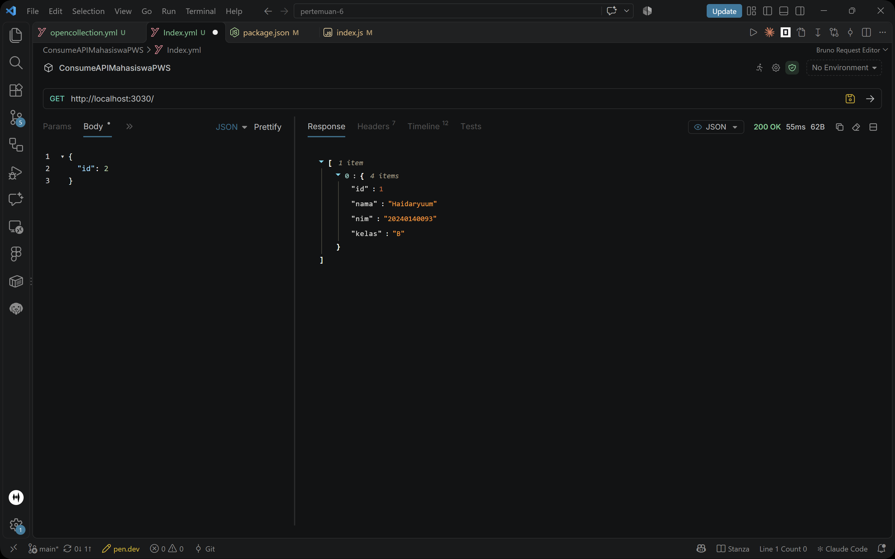
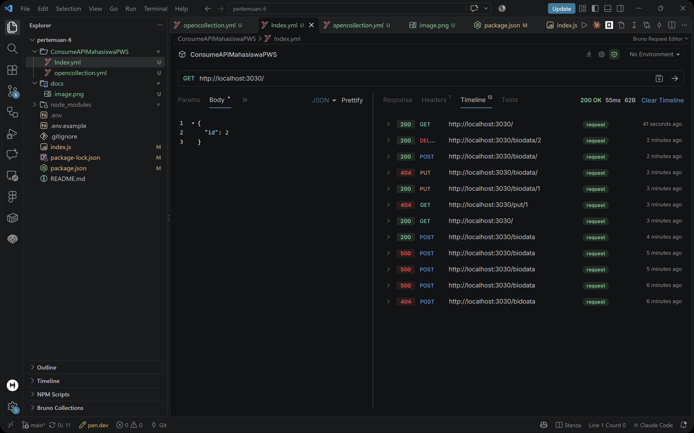

# API CRUD Biodata Mahasiswa

REST API sederhana untuk membaca dan mengelola data biodata mahasiswa menggunakan Express.js dan PostgreSQL.

## Menjalankan

1. Buat database PostgreSQL dan tabel:

   ```sql
   CREATE TABLE biodata (
     id INTEGER PRIMARY KEY,
     nama TEXT NOT NULL,
     nim TEXT NOT NULL,
     kelas TEXT NOT NULL
   );
   ```
2. Buat file `.env` di root proyek:

   ```env
   DB_USER=postgres
   DB_HOST=localhost
   DB_DATABASE=nama_database
   DB_PASSWORD=password_database
   DB_PORT=5432
   ```
3. Instal dependensi dan jalankan:

   ```bash
   npm install
   npm start
   ```

   Server berjalan di `http://localhost:3030`.

## Endpoint

| Method     | Endpoint         | Fungsi                                                  |
| ---------- | ---------------- | ------------------------------------------------------- |
| `GET`    | `/`            | Mengambil semua data biodata                            |
| `POST`   | `/biodata`     | Menambahkan data (`id`, `nama`, `nim`, `kelas`) |
| `PUT`    | `/biodata/:id` | Memperbarui data berdasarkan ID                         |
| `DELETE` | `/biodata/:id` | Menghapus data berdasarkan ID                           |

Request `POST` dan `PUT` menggunakan body JSON, misalnya:

```json
{
  "id": 1,
  "nama": "Nama Mahasiswa",
  "nim": "12345678",
  "kelas": "A"
}
```

## Dokumentasi Gambar

Contoh hasil pengambilan data:



Alur API:


